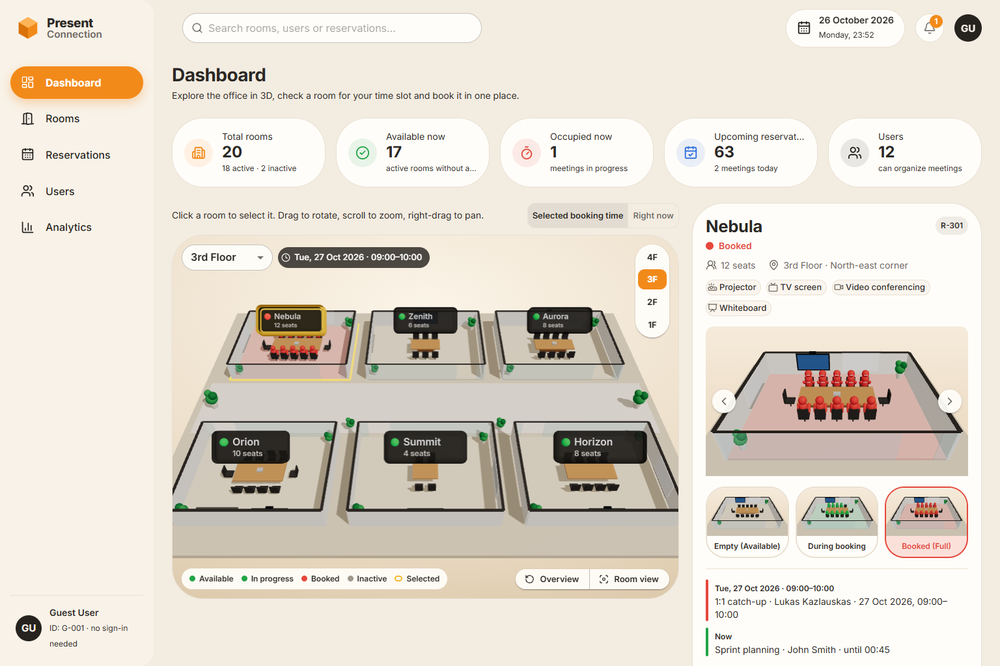
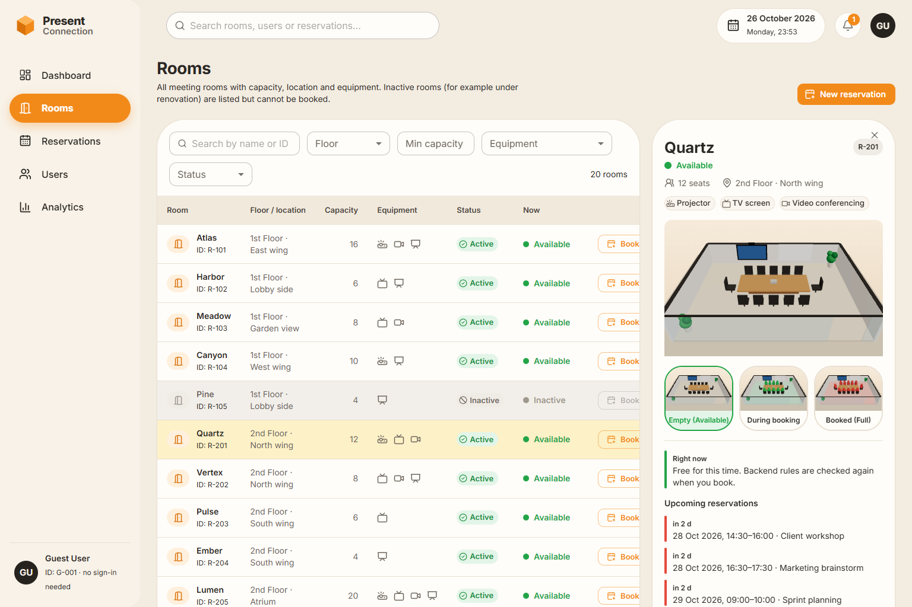
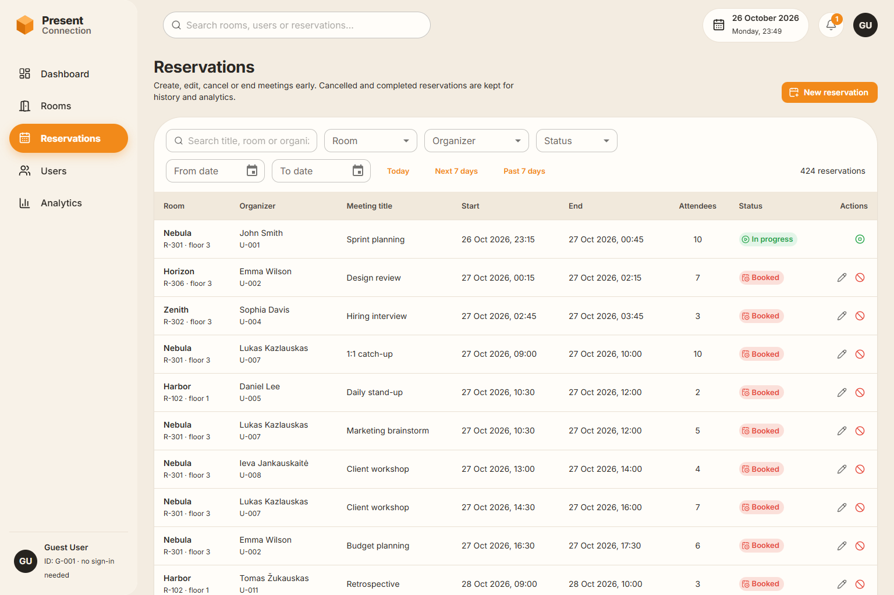
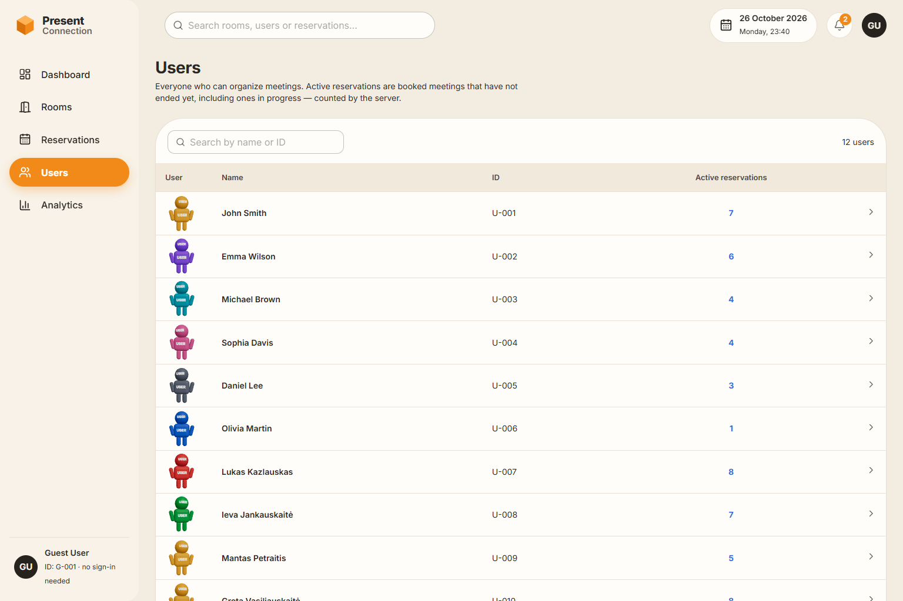
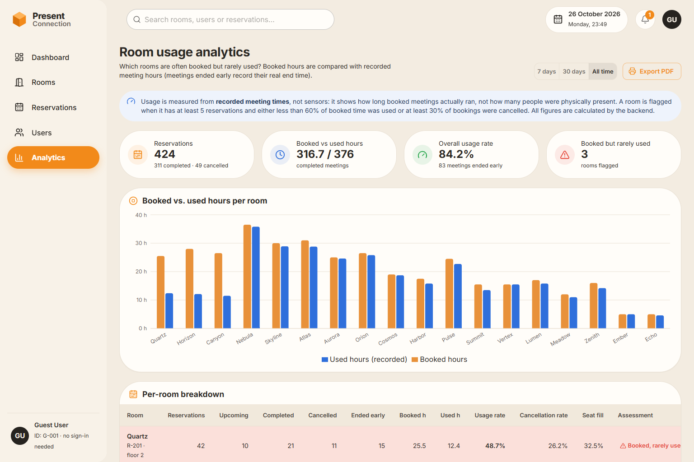
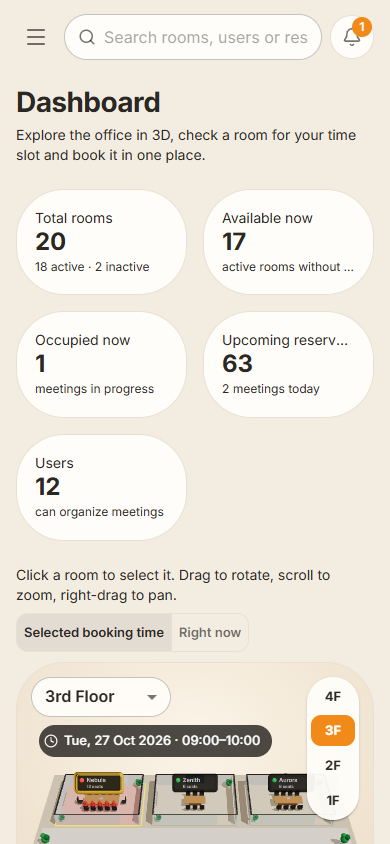

# Caucus · Meeting Room Booking

**Caucus** is a full-stack meeting room reservation system built for the Present Connection IDT internship technical assignment.
Users explore the office in an interactive 3D floor plan, check a room for a time slot, book it, and manage
reservations. An analytics page shows which rooms are **often booked but rarely used**.

- **Backend:** ASP.NET Core 10 Web API · EF Core InMemory · xUnit (56 tests)
- **Frontend:** React 19 · TypeScript · Vite · Material UI · React Three Fiber · TanStack Query · Recharts



---

## Contents

1. [Features](#features)
2. [Quick start](#quick-start)
3. [Architecture](#architecture)
4. [Project structure](#project-structure)
5. [API](#api)
6. [Booking rules](#booking-rules)
7. [Configuration](#configuration)
8. [Testing](#testing)
9. [Time zones](#time-zones)
10. [Limitations of EF Core InMemory](#limitations-of-ef-core-inmemory)
11. [Design decisions and trade-offs](#design-decisions-and-trade-offs)
12. [Screenshots](#screenshots)

---

## Features

| Area | What you can do |
|---|---|
| **Dashboard** | Live headline figures, an interactive **3D floor plan** (rotate, zoom, pan, select rooms, switch floors, reset/focus the camera), a room details panel with a 3D preview, rooms/users summaries, the booking panel, upcoming meetings and a utilization summary. |
| **Rooms** | Table of all rooms (name, ID, capacity, floor/location, equipment, active/inactive, whether it is in use now). Filters: **minimum capacity, equipment (all selected), floor**, plus status and search. Filters live in the URL. |
| **Reservations** | List with room, organizer, title, start/end, attendees and status. **Create, edit, cancel, end early.** Filters: **room, organizer, status, date range**, plus text search. |
| **Users** | Users with ID and their **active reservation count** (calculated by the backend), each shown as a 3D figure with **"USER" on its head and torso**. |
| **Analytics** | Booked vs. recorded hours per room, completed / cancelled / early-ended counts, usage and cancellation rates, and a **"booked but rarely used"** flag with reasons. Export to PDF via the browser's print dialog. |

**Room visual states** (3D floor and previews), always shown with a text label as well as colour:

- **Available**: empty room, green indicator.
- **In progress ("During booking")**: green figures around the table. This is derived from a *Booked* reservation that has started and not ended. It is not a stored status.
- **Booked**: red figures and a red-tinted floor for the selected time slot.
- **Inactive**: greyed room with traffic cones; it cannot be booked.

The floor plan shows the states for the time slot chosen in the booking panel, or "Right now" via the toggle. So a
room with a meeting later today is not shown as in progress now.

## Quick start

### Prerequisites

| Tool | Version used | Notes |
|---|---|---|
| .NET SDK | **10.0** (10.0.403) | `dotnet --list-sdks` |
| Node.js | **20.19+** or 22+ | Vite 8 requires ≥ 20.19 |
| npm | 10.8+ | Use `npm ci` (see note below) |

> **npm 10.8.2 note:** a fresh `npm install` without a lockfile can crash with `Cannot read properties of null (reading 'edgesOut')`
> (an npm arborist bug). `npm ci` installs from the committed `package-lock.json` and works fine. If you need
> `npm install`, use `npx npm@11 install`.

### 1. Backend (http://localhost:5080)

```bash
cd backend
dotnet run --project MeetingRoomBooking.Api
```

Swagger UI: **http://localhost:5080/swagger**. Demo data is seeded automatically on start.

### 2. Frontend (http://localhost:5173)

```bash
cd frontend
npm ci
npm run dev
```

Open **http://localhost:5173**. The Vite dev server proxies `/api` to the backend, so no CORS setup is needed.
To point it at another backend, set `VITE_API_PROXY_TARGET` (dev proxy) or `VITE_API_BASE_URL` (direct URL).

### Other commands

```bash
# backend tests
cd backend && dotnet test

# frontend type-check, lint and production build
cd frontend && npm run typecheck && npm run lint && npm run build
```

## Architecture

```
React (Vite) ──HTTP/JSON──▶ ASP.NET Core controllers ──▶ services ──▶ EF Core InMemory
   │   TanStack Query cache           │ thin               │ all rules and calculations
   │   MUI + React Three Fiber        │ DTOs only          │ BookingValidator (R1–R7)
   └── no business rules              └── IExceptionHandler → uniform error JSON
```

**Backend** (layered, dependency-injected):

- **Controllers** only translate HTTP to and from service calls. No logic.
- **Services** hold all business logic: `ReservationService` (create/edit/cancel/end early), `BookingValidator`
  (rules R1–R7), `RoomService` (filters, availability, occupancy), `UserService` (active counts),
  `AnalyticsService` (usage report), `DashboardService` (headline figures).
- **`ReservationRules`** is the single source of truth for time-dependent interpretation: the overlap expression, what
  "active" means, effective status, and in progress. Queries and the in-memory logic share it, so the rules can't drift.
- **DTOs and a hand-written mapper** (`Mapping/MappingExtensions.cs`) keep entities out of the API. Responses carry
  `canCancel / canEndEarly / canEdit` flags, so the UI never re-implements lifecycle rules.
- **Typed options** (`BookingRulesOptions`, `OfficeOptions`, `AnalyticsOptions`) are bound from `appsettings.json` and
  validated at startup.
- **`TimeProvider`** is injected everywhere "now" matters, so tests run on a frozen clock.
- **Errors:** services throw `ApiException(status, code, message, details)`. `ApiExceptionHandler` turns it, and any
  model-binding failure, into one shape: `{ code, message, details[] }`.

**Frontend:**

- `api/` holds a typed Axios client that converts every failure into an `ApiError` carrying the backend's code and message.
- `hooks/queries.ts` holds TanStack Query hooks. Every reservation mutation refreshes all dependent data (availability,
  counts, dashboard, analytics, 3D states).
- `components/three/` holds the 3D layer. The floor plan has its own canvas and renders on demand. Every small 3D viewport
  (user figures, room previews) is drawn through **one shared canvas** using drei `<View>`, because browsers allow
  only a few WebGL contexts. There is a 2D fallback when WebGL is unavailable.
- `theme/tokens.ts` holds the colour tokens, including the established **table colours** (yellow selected row, red booked row,
  status dots) that all tables read from.

## Project structure

```
meeting-room-booking/
├── backend/
│   ├── MeetingRoomBooking.sln
│   ├── MeetingRoomBooking.Api/
│   │   ├── Configuration/    BookingRulesOptions, OfficeOptions, AnalyticsOptions
│   │   ├── Controllers/      Rooms, Users, Reservations, Insights (analytics, dashboard, settings)
│   │   ├── Data/             AppDbContext, DataSeeder (deterministic demo data)
│   │   ├── DTOs/             request/response records, ErrorResponse
│   │   ├── Errors/           ApiException, ErrorCodes, BookingRuleViolation
│   │   ├── Interfaces/       service contracts
│   │   ├── Mapping/          entity → DTO mapping
│   │   ├── Middleware/       ApiExceptionHandler (uniform errors)
│   │   ├── Models/           Room, User, Reservation, EquipmentType, ReservationStatus
│   │   ├── Services/         business logic, BookingValidator, ReservationRules
│   │   └── appsettings.json
│   └── MeetingRoomBooking.Tests/   xUnit: rules, lifecycle, queries, seed data, HTTP contract
├── frontend/
│   └── src/
│       ├── api/              Axios client + endpoints
│       ├── components/       layout · common · rooms · users · reservations · booking · three
│       ├── context/          OfficeSettings (limits + time zone from the API)
│       ├── hooks/            TanStack Query hooks
│       ├── pages/            Dashboard, Rooms, Reservations, Users, Analytics
│       ├── theme/            MUI theme + colour tokens
│       ├── types/            API types
│       └── utils/            time-zone handling, equipment labels
└── docs/screenshots/
```

## API

Full interactive documentation: **`/swagger`**. All timestamps are ISO 8601 UTC (`2026-10-27T08:00:00Z`).

| Method | Endpoint | Purpose |
|---|---|---|
| GET | `/api/rooms?minCapacity=&floor=&equipment=&equipment=&isActive=&search=` | Rooms (equipment = must have all) |
| GET | `/api/rooms/floors` | Floors with room counts |
| GET | `/api/rooms/{id}` | Room + current meeting + upcoming reservations |
| GET | `/api/rooms/{id}/availability?start=&end=&excludeReservationId=` | Can this room be booked for a window? (same rules as booking) |
| GET | `/api/rooms/occupancy?start=&end=&floor=` | State of each room for a window (Available / InProgress / Booked / Inactive) |
| GET | `/api/users?search=` | Users with active reservation counts |
| GET | `/api/users/{id}` | User + active reservations |
| GET | `/api/reservations?roomId=&organizerId=&status=&from=&to=&search=` | Reservations (date range = overlapping `[from, to)`) |
| GET | `/api/reservations/{id}` | One reservation |
| POST | `/api/reservations` | Create (201) |
| PUT | `/api/reservations/{id}` | Edit an upcoming reservation (re-validated) |
| POST | `/api/reservations/{id}/cancel` | Cancel (record kept, status → Cancelled) |
| POST | `/api/reservations/{id}/end-early` | End an in-progress meeting now |
| GET | `/api/analytics/room-usage?from=&to=` | Usage report |
| GET | `/api/dashboard/summary` | Dashboard figures |
| GET | `/api/settings` | Booking limits and office time zone |

**Error format:** every failure returns the same JSON:

```json
{
  "code": "ROOM_BOOKING_CONFLICT",
  "message": "Nebula is already booked during the selected time (\"1:1 catch-up\", 27 Oct 09:00–10:00 office time).",
  "details": [
    { "code": "ROOM_BOOKING_CONFLICT", "message": "…", "field": null }
  ]
}
```

`details` lists **every** broken rule, most fundamental first. The frontend shows `message` and the remaining details.

| HTTP | Codes |
|---|---|
| 400 | `INVALID_TIME_RANGE`, `MAXIMUM_DURATION_EXCEEDED`, `BOOKING_HORIZON_EXCEEDED`, `ROOM_CAPACITY_EXCEEDED`, `INVALID_ATTENDEE_COUNT`, `ROOM_INACTIVE`, `VALIDATION_ERROR` |
| 404 | `ROOM_NOT_FOUND`, `USER_NOT_FOUND`, `RESERVATION_NOT_FOUND` |
| 409 | `ROOM_BOOKING_CONFLICT`, `ORGANIZER_BOOKING_CONFLICT`, `RESERVATION_NOT_CANCELLABLE`, `RESERVATION_NOT_EDITABLE`, `MEETING_NOT_IN_PROGRESS` |

## Booking rules

Every create **and edit** goes through `BookingValidator` against the current database state, inside a write lock.

| # | Rule | Implementation |
|---|---|---|
| R1 | Max duration | `end − start ≤ MaximumDurationDays`. Exactly 7 days is allowed. Measured in UTC, so DST changes don't distort it. |
| R2 | No overlapping room bookings | Conflict when `existing.Start < requested.End && requested.Start < (existing.ActualEnd ?? existing.End)`. Cancelled reservations never block. Meetings that ended early only block until their actual end. Back-to-back meetings are allowed. |
| R3 | No overlapping organizer bookings | The same overlap test on the organizer, across all rooms. *The assignment says "overlap in date"; this is implemented as overlapping time, so the same person can hold two meetings on one day as long as they don't overlap.* |
| R4 | Valid time range | Start must be strictly in the future; end must be after start. Malformed timestamps are rejected by model validation. |
| R5 | Capacity | `1 ≤ attendees ≤ room.Capacity`. |
| R6 | Booking horizon | `start − now ≤ MaximumBookingHorizonDays`. Exactly 90 days is allowed. |
| R7 | Active rooms only | Inactive rooms are rejected. |

**Reservation lifecycle.** Statuses are exactly `Booked`, `Completed` and `Cancelled`.

- **Cancel** is allowed for upcoming meetings. The record is kept and its status becomes Cancelled.
- **End early** is allowed for meetings in progress. It records `ActualEndDateTime`, keeps the planned end for
  analytics, sets the status to Completed, and frees the rest of the slot.
- A Booked meeting whose end has passed is **reported** as Completed. Nothing rewrites it in storage, so no background
  job is needed.
- An **active reservation** (for the users page) is a Booked reservation that has not ended yet, including meetings in progress.

## Configuration

`backend/MeetingRoomBooking.Api/appsettings.json`:

```json
{
  "BookingRules": { "MaximumDurationDays": 7, "MaximumBookingHorizonDays": 90 },
  "Office": { "TimeZone": "Europe/Vilnius" },
  "Analytics": { "MinimumReservationsForFlag": 5, "LowUsageThresholdPercent": 60, "HighCancellationThresholdPercent": 30 },
  "Cors": { "AllowedOrigins": [ "http://localhost:5173" ] }
}
```

The limits are bound to typed options and validated on startup; none are hard-coded in business logic. The frontend
reads them from `/api/settings` to configure the calendar (booking horizon) and the multi-day option, but the server
always decides. Values can also be overridden with environment variables, e.g. `BookingRules__MaximumDurationDays=3`.

## Testing

```bash
cd backend
dotnet test     # 56 tests
```

Each test gets a **fresh, uniquely named InMemory database** and a **frozen `FakeTimeProvider`**.

| File | Covers |
|---|---|
| `BookingRulesTests` | R1–R7 including boundaries: exactly 7 days, 7 days + 1 min, exactly 90 days, start = now, end = start, adjacent bookings, cancelled not blocking room or organizer, organizer conflict across rooms, configurable limits, all violations reported in order, UTC normalisation of offsets, a 7-day booking across a DST change, a booking crossing midnight |
| `ReservationLifecycleTests` | Cancel frees the room and keeps the record; end early records the actual end, keeps the planned end and frees the rest of the slot; only in-progress meetings can end early; edits don't conflict with themselves but are re-validated; combined filters; list ordering |
| `QueryServiceTests` | Active reservation counts; room filters (capacity, floor, *all* equipment); occupancy states; analytics maths, flags and no-data handling (no divide-by-zero) |
| `SeedDataTests` | The seed never overlaps by room or organizer, for several start moments including just before a DST change |
| `ApiContractTests` | Real HTTP pipeline via `WebApplicationFactory`: 201/400/404/409 and the error body shape |

The frontend was checked with TypeScript (strict), oxlint and a production build, plus a scripted browser run. That
run creates a conflicting booking (backend message shown), an over-capacity booking (capacity message), a valid
booking, cancels it, ends an in-progress meeting early, and applies room filters.

## Time zones

- The API stores and exchanges **UTC** only (`DateTime` with `Kind = Utc`; input accepts any ISO 8601 offset and normalises it).
- The office has **one configured time zone** (`Office:TimeZone`). The UI shows and accepts all times in that zone,
  whatever the viewer's computer is set to. Conversion happens only in `frontend/src/utils/time.ts`.
- Durations and overlaps are compared in UTC, so midnight and DST transitions need no special cases (both are covered by tests).

## Limitations of EF Core InMemory

- **Data is temporary.** Everything resets when the backend restarts. The seed data is regenerated relative to the
  current time, so there are always past, in-progress and upcoming meetings to look at.
- **No transactions or concurrency tokens.** Creating, editing, cancelling and ending meetings is serialised with a
  process-wide `SemaphoreSlim`, so two simultaneous requests can't both pass the overlap check. This works for a single
  instance only; a real database would use a transaction with an appropriate isolation level or a constraint.
- It is not a relational database (no real SQL, no foreign-key enforcement). Fine for the assignment, not for production.

## Design decisions and trade-offs

- **The backend is the authority.** The frontend shows hints (end before start, too many attendees) and a live
  availability check, but it **never blocks a submission on its own rules**. The server re-validates and its message
  is displayed, so you can see the backend's rules in action.
- **Effective status instead of a background job.** Elapsed meetings are reported as Completed when read, which is
  simpler and can't be "late".
- **Equipment as a `[Flags]` enum.** "Has all the requested equipment" becomes one bitwise check.
- **String IDs (`R-301`, `U-001`)** for rooms and users are readable in the UI and logs. Reservations use generated integers.
- **Ordering:** reservation lists show ongoing and upcoming meetings first (soonest first), then history (newest first),
  so actionable rows are on the first page.
- **Analytics honesty:** usage measures *recorded meeting time* (an early end records the real end), not physical
  attendance. Rooms with no completed meetings show "n/a", not 0%. Flag thresholds are configurable.
- **3D performance:** shared geometries and materials, an on-demand render loop for the floor plan, one shared WebGL
  context for all small viewports, a lazily loaded 3D bundle, and a 2D fallback without WebGL.
- **Design:** follows the supplied reference (warm beige, white cards, orange navigation and actions, amber selection,
  green/red states). Table colours (yellow selected row, red booked row, coloured status dots) are defined once in
  `theme/tokens.ts` and shared by every table.
- **Out of scope:** authentication and room administration (create/edit rooms). The assignment needs neither, and the
  booking rules took priority.

## Screenshots

| | |
|---|---|
|  |  |
|  |  |

Mobile layout:


